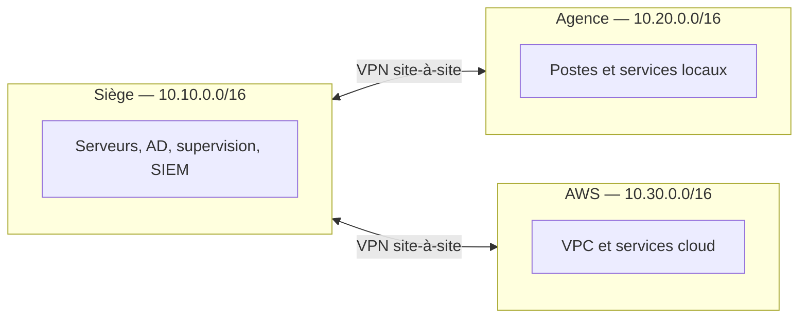

cat > README.md << 'EOF'
# Skills Lab — portfolio infrastructure
> Projets d'infrastructure réseau, systèmes, sécurité, cloud et DevOps, construits autour du SI (système d'information) d'une entreprise fictive : **Kerlab**.

Kerlab est une PME (petite ou moyenne entreprise) fictive d'environ 80 salariés, avec un siège, une agence et une extension dans le cloud AWS (Amazon Web Services). Chaque projet construit une brique de son SI et s'appuie sur les précédentes. Le détail se trouve dans [ROADMAP.md](ROADMAP.md).

## Projets
| # | Projet | Dépôt | Statut | Version | Compétences |
|---|---|---|---|---|---|
| P0 | Socle de virtualisation | `hyperv-lab-platform` | En réalisation | — | Hyper-V, PowerShell, commutateurs virtuels, VLAN (Virtual LAN), images de référence |
| P1 | Réseau multi-sites | `multisite-network-opnsense` | Prévu | — | OPNsense, routage inter-VLAN, VPN (Virtual Private Network) IPsec/WireGuard, OSPF (Open Shortest Path First) |
| P2 | Identité et services Windows | `active-directory-infrastructure` | Prévu | — | AD DS (Active Directory Domain Services), DNS, DHCP, GPO (Group Policy Objects), PKI (Public Key Infrastructure) |
| P3 | Supervision | `monitoring-zabbix` | Prévu | — | Zabbix, SNMP (Simple Network Management Protocol), Prometheus, Grafana |
| P4 | Sécurité et détection | `soc-wazuh` | Prévu | — | Wazuh, Suricata, benchmarks CIS (Center for Internet Security) |
| P5 | Automatisation et IaC (Infrastructure as Code) | `ansible-infrastructure` | Prévu | — | Ansible, WinRM (Windows Remote Management), Molecule, intégration continue |
| P6 | Cloud hybride | `aws-hybrid-cloud` | Prévu | — | AWS, Terraform, VPN site-à-site, DNS hybride |
| P7 | Plateforme conteneurs | `kubernetes-platform` | Prévu | — | k3s, Argo CD, CI/CD (intégration et déploiement continus) |

## Architecture cible


## Méthode
Chaque projet est livré par versions successives (v1 fonctionnelle, v2 durcie ou étendue, v3 avancée), dans un dépôt public qui contient :
- un README de présentation et la documentation d'architecture ;
- les décisions techniques sous forme d'ADR (Architecture Decision Records) ;
- les procédures d'exploitation sous forme de runbooks ;
- le code (PowerShell, Ansible, Terraform…) et des scripts de validation ;
- un CHANGELOG, un tag et une release par version.

Chaque brique est d'abord réalisée manuellement, puis documentée, puis automatisée.

## Fiches de révision
Synthèses des outils et des concepts mobilisés : [revision/](revision/README.md).

## Organisation du dépôt
```
skills-lab/
├── README.md        # ce portfolio
├── ROADMAP.md       # feuille de route des projets
├── revision/        # fiches outils et concepts
├── _templates/      # modèles : README de projet, ADR, runbook, fiche
└── zabbix/          # lab Zabbix antérieur, intégré à P3
```
EOF