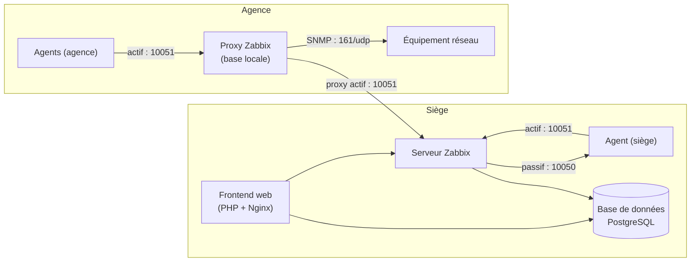

# Zabbix — fiche de révision
> **Catégorie :** outil · **Version de référence :** 7.0 LTS (Long Term Support) · **Mise à jour :** 2026-11-22 · **Projets liés :** P3 Supervision

## L'essentiel
- Zabbix est une plateforme de supervision open source : elle collecte des métriques, les compare à des seuils et alerte.
- Quatre composants : le **serveur** (le cerveau), la **base de données** (la mémoire), le **frontend** web, et les **agents ou proxies** qui collectent.
- Un check est **passif** (le serveur interroge l'agent sur le port 10050) ou **actif** (l'agent se connecte au serveur sur le port 10051).
- On ne configure pas hôte par hôte : on utilise des **templates** et des **macros**.
- Le point unique de défaillance, c'est la **base de données** : sans elle, il n'y a plus d'alertes fiables.

## Rôle et cas d'usage
- **À quoi ça sert :** surveiller la disponibilité et la performance des serveurs, des équipements réseau, des services et des applications, puis alerter avant ou pendant un incident.
- **Quand l'utiliser :** un parc hétérogène (Linux, Windows, réseau en SNMP (Simple Network Management Protocol)), plusieurs sites, un besoin d'alerting et d'historique dans un seul outil.
- **Quand préférer autre chose :** des environnements très dynamiques à base de conteneurs, où Prometheus est la norme ; ou un besoin limité à des graphiques de métriques applicatives.

## Fonctionnement


- **Serveur :** il reçoit les données, évalue les déclencheurs, génère les événements et exécute les actions (alertes, scripts).
- **Base de données :** elle stocke la configuration, l'historique (valeurs brutes), les tendances (agrégats horaires) et les événements.
- **Frontend :** l'interface web et l'API (Application Programming Interface). Il lit la base et interroge le serveur.
- **Agent :** il collecte les données locales d'un hôte. L'agent 2, écrit en Go, est extensible par plugins et remplace progressivement l'agent classique en C.
- **Proxy :** il collecte pour le compte du serveur sur un site distant, stocke les données dans sa propre base et les transmet. Le site continue d'être supervisé pendant une coupure de lien.
- **Cycle de vie d'une donnée :** item (collecte) → historique → déclencheur (seuil) → problème (événement) → action (alerte) → résolution.

## Notions clés
| Notion | Définition | Pourquoi elle compte |
|---|---|---|
| **Hôte** | équipement ou service supervisé | c'est l'unité de base de la configuration |
| **Item** | une métrique collectée, identifiée par une clé (`system.cpu.util`) | sans item, rien n'est collecté |
| **Déclencheur** (trigger) | une expression qui définit un état problème (`avg(/hôte/system.cpu.util,5m)>90`) | il transforme une donnée en problème |
| **Action** | ce qui se passe quand un problème apparaît : notification, escalade, script | c'est elle qui produit l'alerte |
| **Template** | un modèle regroupant items, déclencheurs, graphiques et découvertes | il industrialise la configuration |
| **Macro** (`{$CPU.UTIL.CRIT}`) | une variable définie dans un template et surchargée par hôte | on change un seuil sans modifier le template |
| **LLD** (Low-Level Discovery) | la découverte automatique d'éléments : interfaces, disques, services | elle supervise ce qui apparaît sans intervention manuelle |
| **Historique et tendances** | valeurs brutes conservées peu de temps ; agrégats conservés longtemps | ils déterminent la taille de la base |
| **Dépendance de déclencheur** | un problème « enfant » est masqué si le « parent » est en panne | elle évite une avalanche d'alertes quand un lien tombe |
| **Maintenance** | une période pendant laquelle les alertes sont suspendues | elle évite les fausses alertes pendant une intervention |
| **Autoenregistrement** | un agent actif s'inscrit seul, selon ses métadonnées | il permet de déployer à grande échelle |

## Commandes et chemins utiles
**Déploiement Docker (lab)**
```bash
docker compose up -d                  # démarrer
docker compose ps                     # état et santé des conteneurs
docker compose logs -f zabbix-server  # journaux du serveur
docker compose down                   # arrêter et supprimer les conteneurs ; les volumes nommés restent
```
Images officielles : `zabbix/zabbix-server-pgsql`, `zabbix/zabbix-web-nginx-pgsql`, `zabbix/zabbix-agent2`, `zabbix/zabbix-proxy-sqlite3`. Figer un tag précis (par exemple `alpine-7.0.31`), jamais `latest`.

**Tester la collecte**
```bash
zabbix_get -s <ip_agent> -k agent.ping        # depuis le serveur ou le proxy : teste un check passif (réponse : 1)
zabbix_agent2 -t system.cpu.util              # sur l'hôte : teste une clé localement
zabbix_sender -z <serveur> -s <hôte> -k <clé> -o <valeur>   # envoie une valeur à un item de type trapper
```

**Fichiers et paramètres de l'agent** (`/etc/zabbix/zabbix_agent2.conf`)
| Paramètre | Rôle |
|---|---|
| `Server=` | adresses autorisées à interroger l'agent (checks passifs) |
| `ServerActive=` | serveur ou proxy à contacter pour les checks actifs |
| `Hostname=` | nom de l'hôte ; il doit être **identique** au nom déclaré dans le frontend |
| `TLSConnect=`, `TLSAccept=`, `TLSPSKIdentity=`, `TLSPSKFile=` | chiffrement par PSK (Pre-Shared Key) |

**Exploitation**
- Sauvegarde de la base : `pg_dump`, régulièrement et testée par une restauration.
- Export de la configuration : templates et hôtes en YAML depuis le frontend, versionnés dans Git.
- Auto-supervision : template « Zabbix server health » (files d'attente, processus occupés, cache).

## Ports, protocoles et flux
| Source | Destination | Port | Protocole | Sens de la connexion | Rôle |
|---|---|---|---|---|---|
| Serveur ou proxy | Agent | 10050 | TCP | serveur → agent | checks passifs |
| Agent | Serveur ou proxy | 10051 | TCP | agent → serveur | checks actifs, autoenregistrement |
| Proxy actif | Serveur | 10051 | TCP | proxy → serveur | envoi des données collectées |
| Serveur | Proxy passif | 10051 | TCP | serveur → proxy | récupération des données |
| Serveur ou proxy | Équipement | 161 | UDP | serveur → équipement | interrogation SNMP |
| Équipement | Serveur ou proxy | 162 | UDP | équipement → serveur | traps SNMP |
| Serveur et frontend | PostgreSQL | 5432 | TCP | vers la base | stockage |
| Navigateur | Frontend | 443 (8443 dans le conteneur Nginx) | HTTPS | utilisateur → frontend | interface et API |

Le **sens de la connexion TCP** n'est pas forcément le sens des données : en mode actif, c'est l'agent qui ouvre la connexion, et il envoie ses données dans cette même connexion. C'est ce qui détermine les règles de pare-feu.

## Bonnes pratiques et configuration de référence
- **Mode actif pour les sites distants et les hôtes derrière un NAT (Network Address Translation) :** une seule connexion sortante, rien à ouvrir en entrée.
- **Un proxy actif par site distant**, avec un tampon sur disque (`ProxyBufferMode=disk` ou `hybrid`) pour ne rien perdre en cas de coupure ou de redémarrage.
- **Templates et macros partout** ; les seuils se règlent par macros au niveau des hôtes ou des groupes.
- **Dépendances de déclencheurs** entre le lien du site et ses hôtes.
- **Base de données :** supervisée, sauvegardée, dimensionnée selon les durées d'historique ; TimescaleDB pour les gros volumes.
- **Sécurité :** changer le compte `Admin` par défaut dès l'installation, chiffrer les flux agents et proxy (PSK ou certificats), publier le frontend derrière HTTPS uniquement, aucun secret dans le dépôt (`.env` ignoré, `.env.example` versionné).
- **Versions :** rester sur une branche LTS, appliquer les versions mineures, et sauvegarder la base avant toute mise à jour majeure (le schéma de la base est migré au démarrage).

## Pièges et points d'attention
- **Un agent passif ne collecte rien de lui-même.** Les clés `log[]`, `logrt[]` et `eventlog[]` exigent le mode actif.
- **`Hostname` différent du nom dans le frontend :** les checks actifs sont refusés (« no active checks on server »).
- **`Server=` mal renseigné :** l'agent refuse les connexions passives du serveur ou du proxy.
- **Sens de connexion et pare-feu :** en mode actif, on ouvre le port 10051 vers le serveur, pas le 10050 vers l'agent.
- **Point unique de défaillance :** le cluster haute disponibilité du serveur (nœuds actif et passif) ne protège pas la base ; elle doit avoir sa propre redondance.
- **Tampon du proxy en mémoire seule :** les données non transmises sont perdues au redémarrage.
- **Seuils modifiés directement dans les déclencheurs** au lieu des macros : configuration impossible à maintenir à grande échelle.
- **Historique trop long sur des items fréquents :** la base grossit très vite ; garder l'historique court et s'appuyer sur les tendances.

## Méthode de dépannage
**Hôte indisponible (icône ZBX rouge, checks passifs)**
1. Depuis le serveur ou le proxy : `zabbix_get -s <ip> -k agent.ping`.
2. Connectivité : le port 10050 est-il joignable (pare-feu, routage) ?
3. Configuration de l'agent : l'adresse du serveur ou du proxy figure-t-elle dans `Server=` ?
4. Le service de l'agent tourne-t-il, et que disent ses journaux ?
- **Causes fréquentes :** pare-feu, `Server=` incomplet, agent arrêté, mauvaise interface déclarée dans le frontend.

**Données actives absentes**
1. Journaux de l'agent : un message « no active checks on server » ?
2. `Hostname=` est-il identique au nom de l'hôte dans le frontend ?
3. Le port 10051 du serveur ou du proxy est-il joignable depuis l'agent ?
4. L'hôte est-il bien supervisé par le serveur ou le proxy indiqué dans `ServerActive=` ?

**Frontend : « Zabbix server is not running »**
1. Le conteneur du serveur tourne-t-il (`docker compose ps`) ?
2. Le frontend pointe-t-il vers le bon serveur (variable `ZBX_SERVER_HOST`) ?
3. Le serveur arrive-t-il à joindre la base (journaux du serveur) ?

**Site distant muet**
1. Le proxy est-il vu par le serveur (date de dernière connexion dans le frontend) ?
2. Le lien est-il coupé ? Si oui, le proxy tamponne : vérifier la durée de `ProxyOfflineBuffer`.
3. Les dépendances de déclencheurs masquent-elles correctement les alertes des hôtes du site ?

## Comparaison avec les alternatives
| Outil | Modèle | Points forts | Limites |
|---|---|---|---|
| **Zabbix** | agents, SNMP, proxies ; tout-en-un | supervision d'infrastructure complète, multi-sites, alerting intégré | interface dense ; la base demande de la rigueur |
| **Centreon** | héritier de Nagios, plugins de supervision | très répandu en France, large bibliothèque de plugins | édition complète payante |
| **Prometheus + Grafana** | collecte en pull d'exporteurs, base de séries temporelles, PromQL | standard des environnements conteneurs et Kubernetes | pas de SNMP ni d'inventaire natifs ; plusieurs briques à assembler (Alertmanager, Grafana) |
| **Nagios / Icinga** | checks par plugins | simple, éprouvé | historique et graphiques limités sans modules complémentaires |

## Questions d'entretien
**Différence entre un check passif et un check actif ?**
- Passif : le serveur se connecte à l'agent (10050) et demande une valeur.
- Actif : l'agent récupère sa liste de checks auprès du serveur, collecte et envoie ses résultats (10051).
- Le mode actif est obligatoire pour les journaux, et il est adapté au NAT et aux sites distants.

**Comment superviser un site distant relié par un VPN (Virtual Private Network) peu fiable ?**
- Un proxy actif sur le site : un seul flux sortant vers le siège.
- Un tampon local sur disque qui conserve les données pendant la coupure et les renvoie ensuite.
- Des dépendances de déclencheurs pour ne pas recevoir une alerte par hôte quand le lien tombe.

**Comment changer un seuil sur 500 serveurs ?**
- Le seuil est une macro du template ; on modifie sa valeur une fois, ou on la surcharge au niveau d'un groupe ou d'un hôte.

**Quel est le point faible d'une architecture Zabbix, et comment le traiter ?**
- La base de données : il faut la superviser, la sauvegarder, tester sa restauration et la rendre redondante (réplication PostgreSQL).
- Le cluster haute disponibilité du serveur ne suffit pas sans redondance de la base.

**Zabbix ou Prometheus ?**
- Zabbix pour l'infrastructure classique et le réseau (SNMP, agents Windows et Linux, multi-sites).
- Prometheus pour les conteneurs et les applications cloud-native.
- Les deux coexistent souvent.

## Références
- Documentation officielle Zabbix 7.0 : https://www.zabbix.com/documentation/7.0/
- Politique de cycle de vie : https://www.zabbix.com/life_cycle_and_release_policy (7.0 LTS : support complet jusqu'au 30 juin 2027, support limité jusqu'au 30 juin 2029 ; 8.0 LTS publiée le 5 novembre 2026)
- Images Docker officielles : https://hub.docker.com/u/zabbix